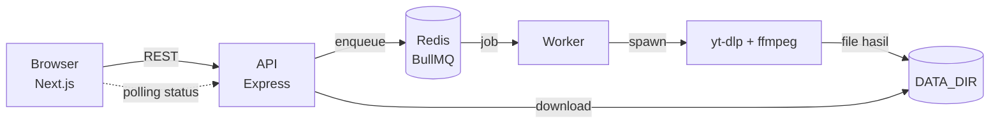

# ✂️ YT Clipper

Potong bagian tertentu dari video atau live YouTube, preview langsung di browser, lalu unduh sebagai **MP4** atau **MP3**. Pemrosesan berjalan di belakang layar lewat antrean, jadi UI tetap responsif dan progres tiap clip bisa dipantau secara real-time.

> ⚠️ **Baca [Catatan Hukum](#%EF%B8%8F-catatan-hukum) sebelum memakai atau mempublikasikan proyek ini.**

## ✨ Fitur

- **Multi-clip** — hingga 10 clip dalam satu job, masing-masing maksimal 10 menit.
- **Preview** — putar bagian yang dipilih lewat YouTube player sebelum diunduh.
- **Ambil waktu dari player** — tentukan titik awal/akhir langsung dari posisi video yang sedang diputar.
- **Tiga mode clip** — video biasa/VOD, rekam live ke depan, dan ambil dari awal live (lihat [Mode Clip](#-mode-clip)).
- **Format** — MP4 (maks. 720p) atau MP3.
- **Progres detail** — tahap, persen, kecepatan, sisa waktu, dan waktu berjalan per clip.
- **Deteksi live otomatis** — status live diambil dari `yt-dlp`, bukan tebakan dari player.
- **Antrean & worker terpisah** — BullMQ + Redis; worker bisa dijalankan lebih dari satu.
- **Pembersihan otomatis** — hasil dihapus setelah 1 jam.
- **Perlindungan dasar** — validasi URL, rate limit per IP, batas antrean, dan proses tanpa shell.

## 🧱 Arsitektur



| Komponen | Teknologi | Peran |
|---|---|---|
| `frontend/` | Next.js 15, React 19 | UI, preview, polling progres |
| `backend/server.js` | Node.js, Express, BullMQ | REST API, validasi, antrean, penyajian file |
| `backend/worker.js` | Node.js, BullMQ | Menjalankan `yt-dlp`/`ffmpeg`, memantau progres |
| Redis | `redis:7-alpine` (Docker) | Penyimpanan antrean |

## 📋 Prasyarat

- **Node.js 20.6+** (backend memakai `node --env-file`)
- **Docker** (untuk Redis) — atau Redis yang sudah ada
- **[yt-dlp](https://github.com/yt-dlp/yt-dlp)** dan **[ffmpeg](https://ffmpeg.org/)** tersedia di `PATH` pada mesin worker

Perbarui `yt-dlp` secara rutin karena YouTube sering berubah:

```bash
yt-dlp -U
```

## 🚀 Memulai

```bash
# 1. Clone
git clone https://github.com/<username>/yt-clipper.git
cd yt-clipper

# 2. Jalankan Redis
docker compose up -d redis

# 3. Siapkan konfigurasi backend
cp backend/.env.example backend/.env     # Windows: copy backend\.env.example backend\.env
```

Lalu buka **3 terminal**:

```bash
# Terminal 1 — API (http://localhost:4000)
cd backend && npm install && npm start

# Terminal 2 — Worker (boleh dijalankan lebih dari satu)
cd backend && npm run worker

# Terminal 3 — Frontend (http://localhost:3000)
cd frontend && npm install && npm run dev
```

Buka <http://localhost:3000>, tempel URL YouTube, tentukan waktu awal/akhir, tambahkan clip, lalu klik unduh.

## ⚙️ Konfigurasi

### Backend (`backend/.env`)

| Variabel | Default | Keterangan |
|---|---|---|
| `PORT` | `4000` | Port API |
| `FRONTEND_ORIGIN` | `http://localhost:3000` | Origin yang diizinkan CORS (pisahkan dengan koma) |
| `REDIS_URL` | `redis://127.0.0.1:6379` | Alamat Redis |
| `DATA_DIR` | `data` | Folder hasil clip. **Harus sama** untuk API dan worker |
| `WORKER_CONCURRENCY` | `2` | Jumlah clip diproses bersamaan per worker |
| `CLIP_TIMEOUT_SEC` | `300` | Batas waktu mode `vod` / `past` |
| `FORCE_KEYFRAMES` | `0` | `1` = potong akurat per frame (re-encode, jauh lebih lambat) |
| `DEBUG_YTDLP` | `0` | `1` = tampilkan semua output `yt-dlp` di log worker |

### Frontend

| Variabel | Default | Keterangan |
|---|---|---|
| `NEXT_PUBLIC_API_URL` | `http(s)://<hostname>:4000` | Alamat API. Buat `frontend/.env.local` bila berbeda |

> **Catatan:** `frontend/next.config.mjs` berisi `allowedDevOrigins` dengan IP LAN. Ganti dengan IP komputer Anda bila ingin mengakses dev server dari perangkat lain, atau hapus bila tidak perlu.

## 🎬 Mode Clip

| Mode | Untuk | Cara kerja |
|---|---|---|
| `vod` | Video biasa dan live yang sudah selesai | Potong `start`–`end` dengan `--download-sections`, ada preview |
| `record` | Live yang sedang berjalan — **Rekam ke depan** | Merekam N detik mulai dari saat job dijalankan |
| `past` | Live yang sedang berjalan — **Ambil dari awal live** | Potong `start`–`end` (waktu sejak live mulai) lewat `--live-from-start`; hanya berhasil jika bagian itu masih tersedia |

> Perilaku mode `past` bergantung pada versi `yt-dlp`. Uji dulu di lingkungan Anda.

## 🔌 API

| Method | Endpoint | Keterangan |
|---|---|---|
| `GET` | `/api/info?url=` | Info ringan video: `liveStatus`, `duration`, `title` |
| `POST` | `/api/jobs` | Buat job baru, mengembalikan `202 { id }` |
| `GET` | `/api/jobs/:id` | Status job dan progres tiap clip |
| `GET` | `/api/jobs/:id/files/:n` | Unduh hasil clip ke-`n` |

Contoh membuat job:

```bash
curl -X POST http://localhost:4000/api/jobs \
  -H "Content-Type: application/json" \
  -d '{
    "url": "https://www.youtube.com/watch?v=VIDEO_ID",
    "format": "mp4",
    "clips": [
      { "mode": "vod", "start": 30, "end": 90, "name": "intro" }
    ]
  }'
```

## 🛡️ Batas Bawaan

| Batas | Nilai |
|---|---|
| Clip per job | 10 |
| Durasi per clip | 1 detik – 10 menit |
| Job menunggu di antrean | 50 |
| Pembuatan job | 10 per menit per IP |
| Permintaan `/api/info` | 20 per menit per IP |
| Masa simpan hasil | 1 jam |

Nilai ini diatur di `backend/shared.js` dan `backend/server.js`.

## 🗂️ Struktur Proyek

```
yt-clipper/
├── docker-compose.yml        # Redis
├── backend/
│   ├── server.js             # REST API + antrean
│   ├── worker.js             # Proses yt-dlp / ffmpeg
│   ├── shared.js             # Konfigurasi & util bersama
│   └── .env.example
└── frontend/
    ├── next.config.mjs
    └── app/
        ├── layout.jsx
        ├── page.jsx          # UI utama
        └── globals.css
```

## 🩺 Pemecahan Masalah

| Gejala | Kemungkinan penyebab / solusi |
|---|---|
| `yt-dlp tidak ditemukan di server` | Pasang `yt-dlp` dan pastikan ada di `PATH` mesin yang menjalankan API/worker |
| `Redis error: ECONNREFUSED` | Redis belum jalan: `docker compose up -d redis` |
| Error `.env: not found` saat `npm start` | Salin `backend/.env.example` menjadi `backend/.env` |
| Clip gagal / 403 / format tidak ditemukan | Perbarui `yt-dlp` (`yt-dlp -U`) |
| Peringatan `No supported JavaScript runtime` | Pasang runtime JS yang didukung `yt-dlp` (mis. Deno); peringatan sengaja ditampilkan di log |
| Clip melebihi batas waktu | Naikkan `CLIP_TIMEOUT_SEC`, atau hindari `FORCE_KEYFRAMES=1` |
| File tidak bisa diunduh | Pastikan `DATA_DIR` API dan worker menunjuk ke folder yang sama |
| CORS error di browser | Tambahkan origin frontend ke `FRONTEND_ORIGIN` |

## 🧪 Catatan Produksi

- API dan worker **harus berbagi `DATA_DIR`** (satu mesin atau satu volume). Untuk worker di mesin lain, pindahkan hasil ke object storage (R2/S3).
- `docker-compose.yml` membuka port Redis `6379`. Di server publik, batasi ke `127.0.0.1:6379:6379` atau jaringan privat.
- Letakkan API di belakang reverse proxy (Nginx/Caddy) dengan HTTPS.

## 🗺️ Belum Ada

- [ ] Akun pengguna
- [ ] Unduh semua clip sebagai ZIP
- [ ] Halaman Terms / Privacy / takedown
- [ ] Dockerfile untuk API dan worker
- [ ] Object storage (R2/S3)

## ⚖️ Catatan Hukum

Mengunduh konten dari YouTube **melanggar Ketentuan Layanan YouTube** kecuali Anda memiliki izin dari pemegang hak cipta atau YouTube. Proyek ini disediakan untuk tujuan edukasi dan penggunaan pada konten milik sendiri atau yang berlisensi bebas. Pengguna bertanggung jawab penuh atas cara penggunaannya. Sebelum menjalankannya sebagai layanan publik, siapkan aspek legal (Terms, Privacy, mekanisme takedown).

Proyek ini tidak berafiliasi dengan YouTube atau Google.

## 📄 Lisensi

Tambahkan file `LICENSE` sesuai pilihan Anda (mis. [MIT](https://choosealicense.com/licenses/mit/)) sebelum dipublikasikan.
